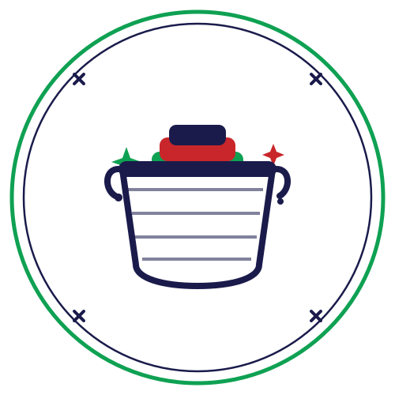

<p align="center">
  
</p>

<h1 align="center">AUN E-Laundry</h1>

<p align="center">
  A centralised campus laundry-management platform for the American University of Nigeria (AUN), Yola.<br>
  <em>Senior Design Project — School of Information Technology &amp; Computing.</em>
</p>

---

## Overview

AUN E-Laundry replaces the informal, manual campus laundry process with a single digital platform that
connects **students**, **laundry workers**, and **administrators**. It brings transparent university
pricing, verified workers, real-time order tracking, two-way ratings, and a structured complaint process
to campus resident life.

## Key features

### 👤 Students
- Register with role, residence hall, and phone number
- Browse **verified** workers in their dorm, ranked by rating
- Build an order with a **live price calculator** — priced from the official university rate
- Track orders through a live status timeline (placed → accepted → picked up → washing → ironing → ready → completed)
- Read notes from their worker and see the worker's phone number once an order is accepted
- Cancel pending or accepted orders, **rate** workers, and **file complaints**

### 🧺 Laundry workers
- Register (accounts require **admin approval**: admins are notified of each sign-up, and until approved a worker can only edit their profile — they are hidden from students and cannot set availability or see orders)
- Accept / reject incoming orders and advance them through the laundry pipeline
- Add **notes** to an order (e.g. a stain that would not come out) — the student is notified
- Toggle availability (available / busy)
- Manage profile & bio, view rating and throughput stats
- Rate students after completion

### 🛡️ Administrators
- Approve, **decline** (with a reason) or revoke worker accounts (notified when a new worker registers)
- The **Head of Residence Life** (`admin@aun.edu.ng`) opens other admin accounts and assigns each one only the responsibilities it needs (workers, orders, complaints, price list, dorms); they can change these or deactivate an admin at any time
- Manage the official **price list** and **residence halls**
- Monitor **all orders** across dorms with filters
- Triage and resolve **complaints**

### Shared
- Role-based access control · in-app notification bell · AUN-branded UI

## Tech stack

| Layer | Technology |
|-------|-----------|
| Framework | Laravel 12 (PHP 8.2+) |
| Auth | Laravel Breeze (Blade) |
| Frontend | Blade, Tailwind CSS, Alpine.js, Vite |
| Database | MySQL |
| Testing | Pest (91 tests, 276 assertions) |

## Getting started

**Requirements:** PHP 8.2+, Composer, Node.js + npm, MySQL.

```bash
# 1. Install dependencies
composer install
npm install

# 2. Configure environment
cp .env.example .env
php artisan key:generate
# then set DB_DATABASE / DB_USERNAME / DB_PASSWORD in .env

# 3. Create the schema and demo data
php artisan migrate --seed

# 4. Build assets
npm run build      # or: npm run dev

# 5. Serve
php artisan serve  # http://localhost:8000
```

### Demo accounts (password: `password`)

| Role | Email |
|------|-------|
| Admin — Head of Residence Life (all areas + admin accounts) | `admin@aun.edu.ng` |
| Admin — Complaints Officer (orders + complaints only) | `complaints@aun.edu.ng` |
| Worker, Dorm AA (approved) | `worker@aun.edu.ng` |
| Workers for the other 8 dorms (approved) | `laundry.bb@aun.edu.ng`, `laundry.cc@…`, `laundry.dd@…`, `laundry.ee@…`, `laundry.ff@…`, `laundry.vb@…` (Volpi Boys), `laundry.ak@…` (Aisha Kande), `laundry.vg@…` (Volpi Girls) |
| Worker (pending approval) | `pending@aun.edu.ng` |
| Student | `student@aun.edu.ng` |

> The nine seeded dorms are AUN's residence halls: Dorm AA, BB, CC, DD, EE, FF, Volpi Boys,
> Aisha Kande and Volpi Girls, each with one approved laundry worker. Price-list rates are
> **placeholders** — replace them with the university's approved rates from the admin Price List screen.

## Running the tests

```bash
php artisan test
```

## Data model (core tables)

`users` (role, dorm, phone) · `dorms` · `service_items` (price list) · `worker_profiles`
(approval / decline + cached stats) · `admin_permissions` (admin responsibilities) · `orders` · `order_items` (price-snapshotted) · `order_status_history`
· `order_notes` (worker notes) · `ratings` (two-way) · `complaints` · `notifications`.

## Installing it as an app

The site is a Progressive Web App (`public/manifest.webmanifest`, `public/sw.js`). Once it is served
over HTTPS, students and staff can install it from the same address:

- **Android (Chrome):** tap **Install** on the banner, or menu ⋮ → *Install app*.
- **iPhone / iPad (Safari):** Share → *Add to Home Screen*.
- **Laptop (Chrome / Edge):** the install icon in the address bar.

It opens full-screen with its own icon. Pages always come from the server (nothing personal is
cached on the device); without a connection an offline page is shown.

## Deploying to Render

`render.yaml` defines a Docker web service (`Dockerfile`, `docker/start.sh`) and a PostgreSQL database.

1. Generate an app key locally: `php artisan key:generate --show`.
2. Push this repository to GitHub, then open
   `https://dashboard.render.com/blueprint/new?repo=https://github.com/Utendg/sdp-elaundry`.
3. Fill in `APP_KEY`, `HEAD_ADMIN_EMAIL` and `HEAD_ADMIN_PASSWORD`, then click **Apply**.

Every start runs the migrations and seeds the nine residence halls, the price list and the Head of
Residence Life account (created once from the variables above). Demo accounts are **not** created in
production unless `SEED_DEMO_DATA=true`. On the free plan the service sleeps after 15 minutes without
traffic, and the free database expires after 30 days, so use paid plans for real use.

## Configuration notes

- **Google Analytics** — optional. Set `GOOGLE_ANALYTICS_ID=G-XXXXXXXXXX` in `.env` to enable tracking.
- **Pricing is server-authoritative** — order totals are always recomputed from the official
  price list; client-supplied prices are ignored.

## Team

| Name | ID |
|------|-----|
| Ibrahim Abdulmajeed Ibrahim | A00024501 |
| Audu David Utennami | A00023995 |
| Vanje Kefas Zawaya | A00024352 |

## Credits

Campus photographs on the landing page are sourced from the public
[aun.edu.ng](https://www.aun.edu.ng) website and remain the property of the American University of Nigeria.

## License

Academic project — American University of Nigeria. Built on the open-source
[Laravel](https://laravel.com) framework (MIT).
